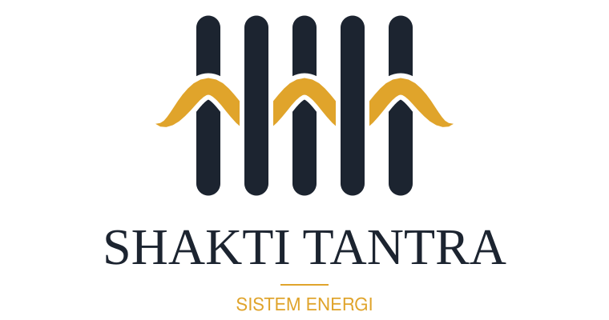
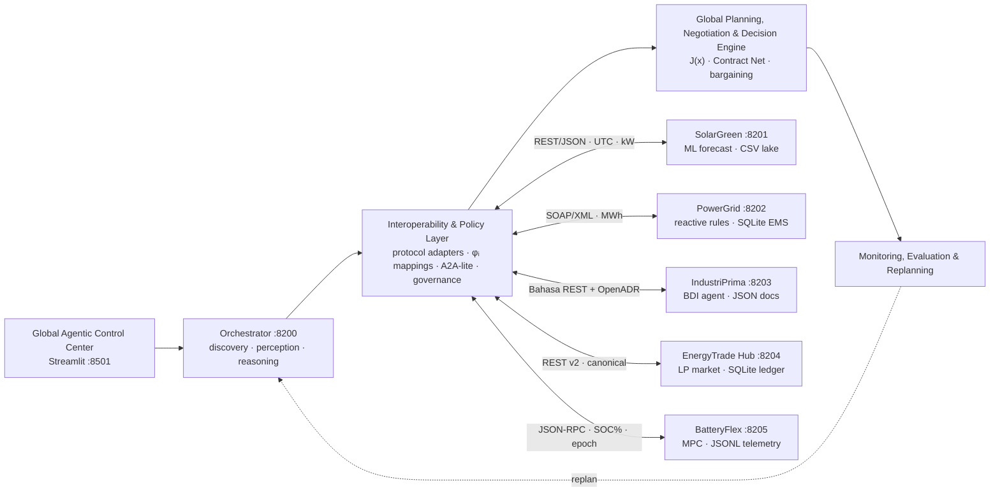

<p align="center"></p>

# Shakti Tantra: Sistem Energi

**A heterogeneous multi-enterprise Agentic AI ecosystem for Smart Energy Trading & Distribution (MVP)**

*Shakti Tantra* comes from the Sanskrit *śakti* (energy, power) and *tantra* (system, framework): "sistem energi".
The logo, *the woven current*, draws that name: *tantra* first meant the warp threads of a loom, so five navy
warp threads stand for the five enterprises, and one gold thread of energy weaves over and under them.

Course: *AI Agentic Technology Systems for Digital Enterprise Ecosystem* (Agen Cerdas Enterprise), BAB 10:
"Tugas Klas Ekosistem", **Case Study 04: Smart Energy Trading and Distribution Ecosystem**.
All companies are fictional and all data is synthetic.

---

## 1. What this MVP demonstrates

Five enterprises with different platforms, databases, protocols, data semantics, agent paradigms and
governance must jointly supply an industrial estate (4,000 kWh, 08:00-16:00 WIB) and adapt when the
environment changes.

| Requirement (Tugas Klas, section A/C/D) | Where it is in the MVP |
|---|---|
| At least 4 different enterprises, heterogeneous on at least 2 dimensions | 5 enterprises that differ on **6** dimensions (table in section 3) |
| Own dashboard (UI/UX) per enterprise, incl. local data and agents | `http://localhost:8201` to `:8205`: overview, agents & models, data explorer, native API, governance, audit, simulated role login |
| Own API server per enterprise, separate browser, own database | 5 FastAPI processes, each with its own store under `data/<enterprise>/` |
| Global Agentic Control Center | Streamlit `http://localhost:8501`, which only uses the orchestrator API |
| At least one predictive AI model + one planning/optimisation algorithm | Gradient-boosted quantile solar forecast, Ridge ARX demand forecast, LP market clearing (HiGHS), MPC, BDI, Contract Net, bargaining |
| Simulation of normal operation, disruption, negotiation, replanning, KPI evaluation | 8 scenarios, mid-window onset, decision trace, before/after comparison |
| Agent communication following the A2A concept; tools/data via API | A2A-style agent cards + A2A-lite envelopes; every native call logged with its wire format |
| Decisions that change *measurably* when the environment changes | Monitoring compares every run with the baseline (kWh per resource, cost, J(x)) |
| LLM "as a reasoning module, not the core of every agent" | Every agent has an LLM mind (Groq first): agent round table (collaboration), explanations, multilingual chat. Binding decisions stay deterministic |
| Clear terms for an international audience | English view on every dashboard (Bahasa terms translated) + Glossary tab in the Control Center |

Reproduction of the document's example (section 5 of Case Study 04):

| | Solar | Battery | Grid | Demand response | Cost |
|---|---:|---:|---:|---:|---:|
| Document: cost-only dispatch | 1,500 kWh | 1,000 kWh | 1,500 kWh | - | **Rp4,400,000** |
| MVP, baseline (both input modes) | 1,500 kWh | 1,000 kWh | 1,500 kWh | 0 | **Rp4,400,000** |
| MVP, "solar production drops 40%" | 900 kWh | 1,000 kWh | 2,000 kWh | 100 kWh at Rp1,741 (negotiated) | Rp4,684,100 |

## 2. Quick start (Windows, VS Code terminal)

Requires Python 3.11+ (tested with 3.12). Open the `smart-energy-ecosystem` folder in VS Code, then:

```powershell
py -m venv .venv
.\.venv\Scripts\Activate.ps1
python -m pip install -r requirements.txt
python scripts/generate_data.py
python scripts/run_all.py
```

`run_all.py` starts the five enterprise servers, the orchestrator and the control center, each in its own
process. Stop everything with `Ctrl+C`. The first start can take a minute while Python imports
scikit-learn and SciPy.

**LLM keys (optional).** Copy `.env.example` to `.env` and add free-tier keys (Groq first, then Gemini and
OpenRouter). Without keys, or with `SEE_LLM=off`, everything still runs and the agents use deterministic
fallbacks instead of LLM reasoning. `.env` is git-ignored; never commit it.

| Component | URL |
|---|---|
| **Global Agentic Control Center** | http://localhost:8501 |
| SolarGreen Energy | http://localhost:8201 |
| PowerGrid Distribution | http://localhost:8202 |
| IndustriPrima | http://localhost:8203 |
| EnergyTrade Hub | http://localhost:8204 |
| BatteryFlex Storage | http://localhost:8205 |
| Orchestrator API (Swagger) | http://localhost:8200/docs |

Every enterprise also serves `/docs` (its native API) and `/.well-known/agent-card.json`.

Other commands:

```powershell
python scripts/run_all.py --no-ui          # API servers only
python scripts/run_all.py --regenerate     # fresh synthetic data + empty run history
python scripts/demo_cli.py                 # terminal demo: baseline vs solar -40%
python scripts/demo_cli.py --all --mode reference
python -m pytest -q                        # 51 tests (unit + end-to-end on ports 18200-18205)
```

## 3. The heterogeneous ecosystem

E<sub>i</sub> = (U<sub>i</sub>, M<sub>i</sub>, D<sub>i</sub>, A<sub>i</sub>, P<sub>i</sub>, G<sub>i</sub>) for every enterprise:

| Enterprise (port) | Platform (simulated) | Database | Native protocol P<sub>i</sub> | Data semantics | Agent paradigm A<sub>i</sub> |
|---|---|---|---|---|---|
| SolarGreen Energy (8201) | Google Cloud | CSV time-series data lake | REST/JSON, AIP-style `POST /api/v1/offers:quote` | avg **kW per 15 min**, **UTC**, gCO2/kWh | **Learning agent**: quantile gradient boosting (P10/P50/P90) + intraday nowcast |
| PowerGrid Distribution (8202) | On-premises legacy SCADA/EMS | SQLite, upper-case legacy schema | **SOAP 1.1 / XML** `POST /soap/GridService` | **MWh**, IDR/**MWh**, `dd/MM/yyyy HH:mm` without offset | **Reactive agent**: safety rules R1-R6 with veto + similar-day load forecast |
| IndustriPrima (8203) | Microsoft Azure | JSON document store | REST/JSON **in Bahasa Indonesia** + **OpenADR 3.0-style** VEN endpoint | kWh, local time without offset, `kebutuhan_kwh`, `beban_fleksibel_kwh` | **BDI agent**: beliefs, desires, plan library, Boulware concession + Ridge ARX demand forecast |
| EnergyTrade Hub (8204) | AWS | SQLite order book & ledger | REST/JSON v2 (canonical) | kWh per hour, IDR/kWh, ISO 8601 +07:00 | **Optimisation / market agent**: multi-period LP (HiGHS), uniform-price duals, settlement |
| BatteryFlex Storage (8205) | Private cloud / edge | JSON Lines telemetry | **JSON-RPC 2.0** `POST /rpc` (`bess.plan_offer`, ...) | kW per step, **SOC %**, **Unix epoch** seconds | **Model Predictive Control**: economic MPC + receding-horizon tracking MPC |

Each enterprise enforces its own governance G<sub>i</sub>, for example PowerGrid's safety veto, IndustriPrima's
10% curtailment cap and human approval above 200 kWh, BatteryFlex's 20% SOC floor, and the Hub's
Rp2,000/kWh price cap and 10 kWh lots. Users U<sub>i</sub> and modules M<sub>i</sub> are listed on every dashboard.

The orchestrator never reads an enterprise database. It speaks each native protocol through an adapter
and translates with explicit semantic mappings φ<sub>i</sub>: D<sub>i</sub> → D\* (canonical model: kWh per
hourly slot, Rp/kWh, ISO 8601 +07:00). The mapping table is shown in the Control Center and in
`orchestrator/semantics.py`.

## 4. Architecture



One run of the adaptive cycle (BAB 10, 10.3.B):

1. **Environment**: the simulation harness changes the world inside an enterprise (clouds, feeder derating,
   rack fault, demand surge, outage). Agents are not told; they must perceive it.
2. **Discovery**: A2A-style agent cards from all enterprises.
3. **Perception**: offers and plans through four native protocols, translated to D\*. If an enterprise is
   unreachable, its last good data is used, derated 20% and flagged.
4. **Reasoning**: supply/demand balance, deviations against the baseline, cause attribution (causer pays).
5. **Planning**: EnergyTrade Hub clears the market with an LP that minimises J(x).
6. **Grid security**: PowerGrid's reactive agent checks the schedule; a veto triggers a security-constrained re-dispatch.
7. **Negotiation**: FIPA Contract Net for flexibility (IndustriPrima DR, BatteryFlex reserve, PowerGrid
   non-firm import), then alternating-offers bargaining with IndustriPrima's BDI agent.
8. **Replanning**: re-clearing with the awarded flexibility (and a second award pass if needed).
9. **Decision → Execution**: instructions in every native format (dispatch set-points, SOAP schedule,
   OpenADR-style DR event, JSON-RPC schedule, settlement).
10. **Governance**: federated policies (grid veto, price cap, human approval, no automated load shedding,
    reserve authorisation, individual rationality U<sub>i</sub> ≥ 0, data minimisation, simulation boundary).
11. **Monitoring**: KPIs, local utilities, comparison with the baseline.

Global objective (Tugas Klas, C.3):

J(x) = α·C(x) + β·T(x) + γ·R(x) − δ·Q(x)

where C is the energy cost (pay-as-bid + VOLL × unserved), T is the demand not served on schedule (DR +
unserved, kWh), R is the risk in risk-kWh (forecast spread, PowerGrid's convex loading-risk curve,
deep-discharge reserve) and Q is the renewable kWh. Default weights are α = 1, β = 100, γ = 200 and
δ = 50 (Rp per unit), and they are editable in the Control Center. Local utility is
U<sub>i</sub> = Revenue<sub>i</sub> − Cost<sub>i</sub> − RiskPenalty<sub>i</sub>. Each enterprise computes and
reports its own U<sub>i</sub>, so private costs never leave the enterprise.

Details: [docs/ARCHITECTURE.md](docs/ARCHITECTURE.md).

### 4.1 LLM-based agent communication across languages

Following the course document ("LLM dapat ditambahkan sebagai modul reasoning ... tetapi tidak wajib menjadi
inti seluruh agen"), every agent keeps its deterministic decision model. The LLM is used for what real
enterprises need when their agents talk to each other: **communication across languages**. As in a real
ecosystem, every company also runs **its own LLM** from its own vendor:

| Agent | Working language | Own LLM (vendor) | Why this is realistic |
|---|---|---|---|
| SolarGreen Energy | 中文 (Mandarin) | `qwen/qwen3.8-27b` (Alibaba Qwen, via Groq) | Chinese parent company standardises on Qwen |
| PowerGrid Distribution | Bahasa Indonesia | `openai/gpt-oss-120b` (OpenAI open-weight, via Groq) | regulated operator self-hosts an open-weight model on-premises |
| IndustriPrima | Bahasa Indonesia | `openai/gpt-oss-20b` (OpenAI, via Groq) | Azure customer uses an OpenAI model |
| EnergyTrade Hub | English | `nvidia/nemotron-3.5-super-vl` (NVIDIA, OpenRouter free) | AWS-hosted platform runs NVIDIA NIM models |
| BatteryFlex Storage | English | `gemini-3.1-flash-lite` (Google) | edge gateway needs a small, fast model |
| Facilitator and Explainer (orchestrator) | viewer's language | `gemini-3.5-flash-lite` (Google) | the ecosystem operator's own platform |

- **Speaking and understanding.** An agent writes every message to other agents in its own working
  language. The **receiver's own LLM** interprets each incoming message into the receiver's language: a
  faithful translation, the FIPA-ACL performative (INFORM, REQUEST, PROPOSE, REFUSE, ...) and the intent.
  Messages in the receiver's own language are delivered as they are, with no LLM call.
- **Deterministic checks on the LLM.** Every number of the original (kWh, Rp, %, hours) must survive the
  translation (`common/multilingual.py` normalises locales: Indonesian `Rp1.741` = English `Rp1,741`). A
  dropped or invented number is flagged next to the message. A "translation" that is still the original
  text or in the wrong script (Chinese characters in a Bahasa rendering) triggers one stricter retry and is
  flagged if it fails again. An answer cut off at the token limit is never shown; the next model answers.
- **Round table in two rounds.** When agents perceive a deviation or a deficit, the Facilitator Agent opens a
  round table over the A2A layer. Round 1: every agent states its position in its own language. Round 2
  (cross-talk): every agent's own LLM understands the other four messages and the agent replies to
  specific agents. For example, PowerGrid reads SolarGreen's Mandarin shortfall notice in Bahasa Indonesia
  and answers that rule R5 forbids extra import. The Facilitator then synthesises agreements, conflicts and
  recommended actions in the viewer's language. It stays *advisory*: the LP market, Contract Net and safety
  rules still decide (the solar −40% run costs Rp4,684,100 with or without LLM).
- **Agent ↔ agent conversation.** In the Control Center (**Ask the agents → Agent ↔ agent**) you pick two
  agents and give an instruction in any language. The sender writes the message in its language, the
  receiver understands it and answers in its own language, and the sender understands the answer.
- **What-if languages.** In the Simulation tab, *Agent working languages (what-if)* lets an agent speak
  another language for one run (for example BatteryFlex in Japanese); the others still understand it.
- **Viewer language.** The synthesis, the explanation and each sender's rendering of its message are shown in
  the language you choose. Every original text stays visible next to it.
- **A2A conversational layer.** Every enterprise exposes the same A2A-style JSON-RPC `message/send` endpoint
  (`POST /a2a`, modes `ask`, `deliberate`, `crosstalk`, `compose`, `converse`, `understand`). Its agent card
  publishes its working language and its LLM.
- **Backup and free-tier limits.** If an agent's own LLM is rate-limited, out of free quota or down, the call
  falls back to Groq (`gpt-oss-120b`, `qwen3.8-27b`, `gpt-oss-20b`), then Gemini, then OpenRouter. On a "try
  again in 0.8 s" reply (HTTP 429) the client waits briefly (up to 4 s, `SEE_LLM_MAX_WAIT`) and keeps the
  agent on its own model. Free tiers also cap daily use: Groq allows Qwen 200,000 tokens a day (about ten
  runs with a round table) and OpenRouter about 50 requests a day. After heavy use an agent's backup
  answers until the rolling 24-hour window frees quota. Every message shows the model that actually
  replied. Stored error messages are sanitised, so account IDs never reach run records.
- **Explanation and chat.** After every run the Explainer Agent narrates what happened and why. The **Ask the
  agents** tab and each dashboard's **Ask agent** tab also accept questions from humans in any language.
- **Privacy by construction.** For external parties (other agents, the Control Center), an agent's LLM never
  sees private data such as reservation prices, loss values, internal costs or network topology, so it
  cannot leak them. Internal users of the enterprise's own dashboard get the full picture.

Every enterprise can change its LLM or language without code changes: `SEE_LLM_<ENTERPRISE>=provider:model`
(e.g. `SEE_LLM_POWERGRID=gemini:gemini-3.5-flash-lite`) and `SEE_LANG_<ENTERPRISE>=ja`.

### 4.2 English view and glossary

IndustriPrima keeps its native schema in Bahasa Indonesia on purpose (semantic heterogeneity). Every
dashboard has a **View: English / Native terms** switch (English by default) that translates field names,
status values, BDI plans and reasons, and the Control Center has a **Glossary (EN)** tab that explains
domain terms (SOC, headroom, VTN/VEN, BDI, MPC, J(x), causer pays, ...).

## 5. Scenarios and results

Two input modes:
- **Agent forecasts**: every enterprise uses its own models (solar GBM, demand Ridge ARX, battery MPC).
- **Case Study 04 table**: the document's exact declared values.

The synthetic data is calibrated so that both modes start from the document's numbers.

Results with default weights (reference mode; forecast mode gives the same dispatch and cost, with a
slightly different J(x) because of forecast uncertainty):

| Scenario | Solar | Battery | Grid | DR | Reserve | Unserved | Cost (Rp) | Status / what happened |
|---|---:|---:|---:|---:|---:|---:|---:|---|
| Normal operation | 1,500 | 1,000 | 1,500 | 0 | 0 | 0 | 4,400,000 | COMPLETED |
| Solar production −40% | 900 | 1,000 | 2,000 | 100 | 0 | 0 | 4,684,100 | COMPLETED: Contract Net + bargaining (Rp1,950 ask → Rp1,741), SolarGreen pays the balancing cost |
| Feeder derated to 65% | 1,500 | 1,000 | 1,180 | 310 | 0 | 10 | 4,524,230 | AWAITING_APPROVAL: PowerGrid veto → re-dispatch; DR > 200 kWh and 10 kWh load shedding need humans |
| Battery rack fault (50%) | 1,500 | 500 | 1,950 | 50 | 0 | 0 | 4,522,050 | COMPLETED: BatteryFlex pays the balancing cost |
| Demand +20% | 1,500 | 1,000 | 2,000 | 300 | 0 | 0 | 5,572,300 | AWAITING_APPROVAL: Energy Manager must approve 300 kWh DR |
| Solar −40% + urgent order | 900 | 1,000 | 2,000 | 0 | 100 | 0 | 4,700,000 | AWAITING_APPROVAL: BDI agent refuses DR (desire D1) → battery deep-discharge reserve needs PowerGrid authorisation |
| SolarGreen cloud outage | 720 | 1,000 | 2,000 | 280 | 0 | 0 | 4,835,480 | AWAITING_APPROVAL: stale solar data (derated), DR 280 kWh needs approval |
| Solar −40% + feeder 80% | 900 | 1,000 | 1,990 | 110 | 0 | 0 | 4,688,510 | COMPLETED: balancing cost split SolarGreen 99% / PowerGrid 1% |

Every disruption can also start mid-window ("Disruption starts at" in the Control Center). Slots that
already ran keep the plan in execution, and only the remaining hours are re-planned.

## 6. Five-minute demo

1. Open http://localhost:8501, then the **Ecosystem** tab: architecture, heterogeneity matrix, φ<sub>i</sub> mappings.
2. **Simulation** tab: choose *Normal operation* and *Case Study 04 table*, then **Run agentic cycle**.
   The result is Rp4,400,000 with the doc's dispatch.
3. Choose *Solar production drops 40%*, then **Run agentic cycle**. Walk through the decision trace:
   deficit 100 kWh → Contract Net (PowerGrid refuses under rule R5) → bargaining chart → re-dispatch →
   "decision changed" table.
4. **Agent messages** tab: open a SOAP message (PowerGrid), a JSON-RPC message (BatteryFlex) and a Bahasa
   negotiation message (IndustriPrima). Each shows the canonical payload next to the native wire format.
5. Run *Industrial demand +20%*. The status becomes AWAITING_APPROVAL. Open the IndustriPrima dashboard
   (:8203), set the role to *Energy Manager*, and approve the event in **Approvals**. Back in the
   Control Center, press **Sync approvals from IndustriPrima**; the run becomes COMPLETED.
6. In the solar −40% run, scroll to **Collaboration: multilingual agent round table**. Round 1 shows each
   agent's message in its own language (SolarGreen in Mandarin, PowerGrid and IndustriPrima in Bahasa
   Indonesia, EnergyTrade and BatteryFlex in English); round 2 shows their replies to each other. Open *How
   the receivers understood it* to see every receiver's own translation and the number check. Read the
   **Explainer Agent** box; set *Viewer language* to Bahasa Indonesia to see the synthesis in Bahasa.
7. **Ask the agents → Agent ↔ agent**: SolarGreen (中文) asks PowerGrid (Bahasa Indonesia) about non-firm
   import; PowerGrid understands the Mandarin message and answers in Bahasa, and SolarGreen understands the
   answer. In *Human → agent*, ask IndustriPrima "Berapa harga reservasi DR anda?" (it refuses: private
   data), then ask the Explainer Agent "Why does SolarGreen pay the balancing cost?".
8. **Evaluation** tab: cost, flexibility and KPIs across all runs. **Glossary (EN)** explains every term.

For the full team presentation (who presents what, a 20-step script with the expected numbers, troubleshooting,
likely questions and a quiz), see [docs/STUDY_GUIDE.md](docs/STUDY_GUIDE.md).

## 7. Tests

`python -m pytest -q` runs 51 tests (the LLM is switched off or mocked in all of them, so they need no network or keys):
- `tests/test_market_reference.py`: the LP reproduces Rp4,400,000; the −40% case needs exactly
  100 kWh DR; shared inverter limit; price cap; lot rounding.
- `tests/test_semantics.py`: φ<sub>i</sub> mappings (kW@15 min UTC, MWh, legacy time, epoch, Bahasa local time).
- `tests/test_agents.py`: BDI plans and deliberation, bargaining convergence, MPC, reactive rules, Contract Net.
- `tests/test_integration.py`: all six servers as real processes on ports 18200-18205 with a temporary data
  folder. Covers the doc reference case, adaptation with negotiation, forecast mode, human approval with a
  role check, graceful degradation during an outage, mid-window replanning, and the collaboration layer
  (round table, explanation, A2A JSON-RPC, privacy, glossary).
- `tests/test_llm.py`: the LLM client against a mocked HTTP transport: Groq-first fallback chain, short
  rate-limit wait on the same model, cool-down after a long one, sanitised errors, JSON mode, cache, and
  the agent mind's privacy (round tables only see external facts).
- `tests/test_multilingual.py`: the number check across languages and locales, each agent's own LLM with the
  shared backup, vendor-specific request shapes (OpenRouter thinking off, Gemma), the receiver's own LLM
  interpreting only foreign messages, the untranslated-echo guard with its retry, and the offline fallbacks.

## 8. Project structure

```
smart-energy-ecosystem/
├── common/            config, canonical model D*, A2A-lite, storage engines, enterprise server shell,
│                      llm.py (per-agent LLMs, Groq-first backup), agent_mind.py (LLM reasoning and
│                      multilingual messaging), multilingual.py (languages, number check), glossary.py
├── enterprises/
│   ├── solargreen/    ML forecaster (quantile GBM), physics, CSV lake, REST/JSON app
│   ├── powergrid/     reactive rules, load forecast, SOAP helpers, SQLite EMS app
│   ├── industriprima/ BDI agent, Ridge ARX forecaster, JSON docs, Bahasa REST + OpenADR-style app
│   ├── energytrade/   LP market clearing, SQLite order book, REST v2 app
│   └── batteryflex/   MPC, JSONL telemetry, JSON-RPC app
├── orchestrator/      adapters, semantics (phi_i), bus, engine, negotiation, policy, evaluation,
│                      collab.py (round table, explanations, Q&A), API
├── frontend/          enterprise.html (dashboard shell), control_center.py (Streamlit), brand/ (logo SVGs)
├── scripts/           generate_data.py, run_all.py, demo_cli.py
├── tests/             unit + end-to-end tests
├── docs/              ARCHITECTURE.md (specification), STUDY_GUIDE.md (demo and study guide), img/
└── data/              generated per-enterprise databases (created by generate_data.py)
```

## 9. MVP scope and limitations

- This is an academic **simulator**. No real grid, plant, battery or load is controlled, and settlement is
  `SIMULATED_SETTLED`.
- Cloud platforms are represented, not deployed: every enterprise runs locally on its own port.
- Login is a simulated role selector (no authentication). Roles are enforced only where it matters for
  the demo (IndustriPrima approvals).
- One 8-hour window, hourly slots, no battery charging inside the window.
- The A2A-lite envelope and the OpenADR-style event follow the *concepts* of A2A and OpenADR 3.0. They are
  not complete implementations of those specifications.
- Parameters (tariffs, emission factor 0.87 kgCO2/kWh, VOLL, risk weights) are synthetic assumptions,
  not official values.
- LLM text is advice and can be wrong or imprecise. It is grounded on the facts it receives, but always
  check it against the deterministic decision trace. Free-tier rate limits (Groq: about 8k tokens per
  minute per model) can push calls onto the fallback chain, so answers may come from a different model.

Candidate next iterations: real authentication and RBAC, an LLM-based explanation agent, MCP tools for
the agents, multi-day rolling horizon with battery charging, MQTT telemetry, automatic replanning after
a human rejects a DR event, Docker deployment per "cloud", and a fuller specification document.

## 10. References

- Course document: BAB 10, *Enterprise Ecosystem Intelligence and Adaptive Agentic AI Systems*, tab "Tugas Klas Ekosistem".
- Wooldridge, M. (2009). *An Introduction to MultiAgent Systems*, 2nd ed. Wiley. (BDI, Contract Net, negotiation)
- Russell, S. and Norvig, P. (2021). *Artificial Intelligence: A Modern Approach*, 4th ed. Pearson.
- Rao, A.S. (1996). AgentSpeak(L): BDI agents speak out in a logical computable language. *Lecture Notes in Computer Science*. https://doi.org/10.1007/BFb0031845
- Smith, R.G. (1980). The Contract Net Protocol: High-Level Communication and Control in a Distributed Problem Solver. *IEEE Transactions on Computers*, C-29(12). https://doi.org/10.1109/TC.1980.1675516
- Faratin, P., Sierra, C. and Jennings, N.R. (1998). Negotiation decision functions for autonomous agents. *Robotics and Autonomous Systems*, 24(3-4). https://doi.org/10.1016/S0921-8890(98)00029-3
- NIST (2023). *AI Risk Management Framework (AI RMF 1.0)*.
- Agent2Agent Protocol: https://a2a-protocol.org · OpenADR: https://www.openadr.org · Model Context Protocol: https://modelcontextprotocol.io
