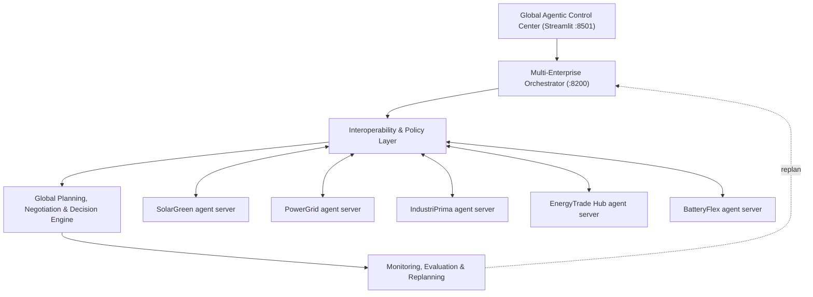
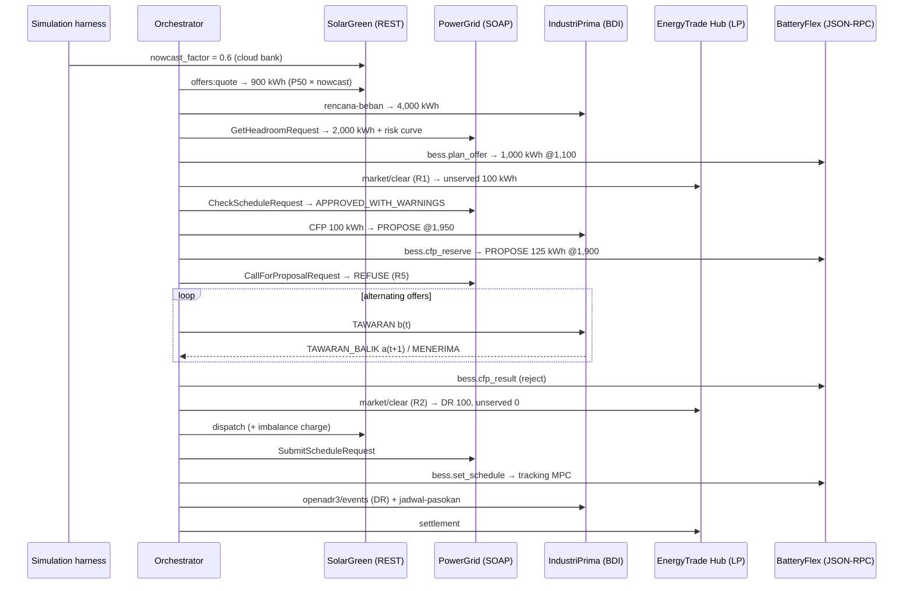

# Shakti Tantra: architecture and specification (MVP)

*Shakti Tantra* ("sistem energi"; Sanskrit *śakti* = energy, *tantra* = system) is the heterogeneous
multi-enterprise ecosystem for **Case Study 04: Smart Energy Trading and Distribution** (BAB 10,
"Tugas Klas Ekosistem"). This document specifies the enterprises, the global architecture, the
interoperability layer, the algorithms and the governance of the MVP.

## 1. Business problem and goal

An industrial estate (IndustriPrima) needs **4,000 kWh** in the simulation period (18 Nov 2026,
08:00-16:00 WIB, eight hourly slots). Supply comes from a solar plant, the distribution grid and a
battery. When solar production falls (clouds), the ecosystem must find additional supply and adjust
industrial consumption. The goal is to meet demand at minimum cost and risk, with maximum renewable
energy, without violating grid safety limits or any enterprise's policies, and with a decision every
party can accept.

Ecosystem: ℰ = {E<sub>SG</sub>, E<sub>PG</sub>, E<sub>IP</sub>, E<sub>ET</sub>, E<sub>BF</sub>}, n = 5 ≥ 4, and
E<sub>i</sub> = (U<sub>i</sub>, M<sub>i</sub>, D<sub>i</sub>, A<sub>i</sub>, P<sub>i</sub>, G<sub>i</sub>).

## 2. Enterprise specifications

### SolarGreen Energy: renewable generator (port 8201)
- **Business goal**: sell as much solar energy as possible at or above the Rp850/kWh floor while keeping forecast error low.
- **U**: Plant Operator, Data Scientist, Commercial Manager.
- **M**: weather intake (NWP); solar forecasting (P10/P50/P90 per 15 min); intraday nowcast; availability & offer (Rp900/kWh); dispatch & local utility; data explorer & audit.
- **D**: CSV data lake: `nwp_forecast_archive.csv` and `scada_generation.csv` (365 days × 96 intervals = 35,040 rows each), `nwp_forecast_sim_day.csv`, `declared_availability.csv`, `forecasts_issued.csv`, `dispatch_log.csv`, `site.json`, model files.
- **A**: Solar Forecast Agent (learning agent), Availability & Offer Agent (rule-based pricing), Dispatch Agent (reactive).
- **P**: REST/JSON with AIP-style custom methods: `POST /api/v1/forecasts:generate`, `POST /api/v1/offers:quote`, `POST /api/v1/dispatch`. Average kW per 15 minutes, UTC timestamps (`Z`), IDR/kWh, gCO2/kWh.
- **G**: shares only aggregated availability and forecast spread (never raw SCADA); price floor Rp850/kWh; set-points accepted only from the orchestrator (simulated).

### PowerGrid Distribution: distribution system operator (port 8202)
- **Business goal**: serve the estate within its 250 kW connection contract without violating feeder thermal limits or the N-1 margin.
- **U**: Grid Operator, Network Planner, Key Account Manager.
- **M**: load monitoring, load forecasting, headroom & tariff, constraint checking (verdicts), emergency capacity (Contract Net participant).
- **D**: SQLite EMS database with an upper-case legacy schema: `FEEDER`, `CONN_AGREEMENT`, `GRID_RULE`, `BG_LOAD_HIST` (90 days hourly), `GRID_SCHEDULE`, `RULE_EVENT`.
- **A**: Grid Safety Agent (reactive, condition-action rules with veto), Load Forecast Agent (statistical), Headroom & Tariff Agent.
- **P**: SOAP 1.1/XML at `POST /soap/GridService` with operations `GetHeadroomRequest`, `CheckScheduleRequest`, `CallForProposalRequest`, `SubmitScheduleRequest`. Energy in MWh, tariff in IDR/MWh, time as `dd/MM/yyyy HH:mm` (local, no offset).
- **G**: safety veto; network topology and other customers' loads are never shared; no non-firm emergency import above 70% feeder utilisation (R5); no real switching.

### IndustriPrima: industrial estate with flexible load (port 8203)
- **Business goal**: meet the production plan at the lowest energy cost, offer flexible load only when fairly compensated, reach a 30% renewable share.
- **U**: Energy Manager (approves DR above 200 kWh), Production Planner, Finance Analyst.
- **M**: demand planning, flexible load scheduling (merit order of processes), DR negotiation, DR participation (OpenADR-style VEN), human approvals.
- **D**: JSON document store with collections in Bahasa Indonesia: `riwayat_beban` (8,760 hourly docs, separate file), `rencana_produksi`, `proses_fleksibel`, `kebijakan_energi`, `negosiasi`, `event_dr`, `persetujuan`, `jadwal_pasokan`, `prakiraan`.
- **A**: BDI Energy Agent (Belief-Desire-Intention), Demand Forecast Agent (Ridge ARX).
- **P**: REST/JSON in Bahasa Indonesia: `GET /api/v1/rencana-beban`, `POST /api/v1/negosiasi/dr`, `POST /api/v1/jadwal-pasokan`, plus OpenADR 3.0-style `POST /openadr3/events` and `GET /openadr3/reports`. kWh per hour, local time without offset.
- **G**: curtailment ≤ 10% of hourly load (critical load never offered); DR above 200 kWh needs the Energy Manager; the reservation price and loss values stay private; urgent orders override DR.

### EnergyTrade Hub: market operator (port 8204)
- **Business goal**: clear the market efficiently and transparently, earn a Rp10/kWh fee, keep a correct ledger.
- **U**: Energy Trader, Market Analyst, Settlement Officer.
- **M**: order book, bid matching / clearing (LP), price optimisation (dual prices), price forecast, settlement.
- **D**: SQLite: `participants`, `market_rules`, `price_history` (90 days hourly), `sessions`, `orders`, `clearing_results`, `trades`, `settlements`.
- **A**: Market Clearing Agent (LP optimisation), Price Forecast Agent (moving average), Settlement Agent.
- **P**: REST/JSON v2 in the canonical model: `POST /api/v2/market/clear`, `GET /api/v2/market/price-forecast`, `POST /api/v2/settlement`, `GET /api/v2/market/rules`.
- **G**: price cap Rp2,000/kWh; 10 kWh lots; settlement is `SIMULATED_SETTLED`.

### BatteryFlex Storage: battery operator (port 8205)
- **Business goal**: earn a margin above charging and degradation cost without ever violating SOC limits.
- **U**: Storage Operator, Asset Manager.
- **M**: SOC monitoring, offer planning (economic MPC), discharge scheduling (tracking MPC), emergency reserve, health monitoring.
- **D**: `telemetry.jsonl` (30 days hourly), `schedules.jsonl`, `bess_config.json`.
- **A**: MPC Dispatch Agent, Storage Offer Agent (cost-based), Battery Health Monitor (reactive).
- **P**: JSON-RPC 2.0 at `POST /rpc` with methods `bess.get_state`, `bess.plan_offer`, `bess.cfp_reserve`, `bess.cfp_result`, `bess.set_schedule`. kW per step, SOC in %, Unix epoch seconds.
- **G**: SOC ≥ 20% (10-20% only as authorised emergency reserve); ≤ 250 kW; offer price ≥ reservation price.

Heterogeneity: the enterprises differ on **platform, database, protocol, data semantics, agent paradigm
and governance**. The course requires at least two dimensions.

## 3. Global architecture



| Layer | Code | Responsibility |
|---|---|---|
| Enterprise agent servers | `enterprises/*/app.py` | Own data, own agents, own native API and dashboard |
| Interoperability & policy layer | `orchestrator/adapters.py`, `semantics.py`, `bus.py`, `policy.py` | Protocol adapters, φ<sub>i</sub> mappings, A2A-lite logging, federated governance |
| Global planning, negotiation & decision | `orchestrator/engine.py`, `negotiation.py`, Hub `market.py` | Adaptive cycle, Contract Net, bargaining, LP clearing |
| Monitoring & evaluation | `orchestrator/evaluation.py` | KPIs, local utilities, baseline comparison |
| Control center | `frontend/control_center.py` | Sees only the orchestrator API |

The Control Center accesses only data shared through the orchestrator API, never an enterprise database
(Tugas Klas, C.1).

## 4. Interoperability

### 4.1 Canonical model D\*
`common/canonical.py`: `SupplyOffer`, `DemandBid`, `ClearingRequest` and `ClearingResult`, with energy in
kWh per hourly slot, prices in Rp/kWh and time in ISO 8601 with +07:00.

### 4.2 Semantic mappings φ<sub>i</sub>: D<sub>i</sub> → D\*

| Enterprise | Native | Canonical | φ<sub>i</sub> |
|---|---|---|---|
| SolarGreen | `available_kw` avg kW per PT15M, UTC | `max_kwh[h]` | Σ kW × 0.25 h per WIB hour |
| SolarGreen | `p10_kw` | `uncertainty_kwh[h]` | Σ (available − P10) × 0.25 h |
| SolarGreen | gCO2/kWh | kg/kWh | ÷ 1000 |
| PowerGrid | `headroomMWh` | `max_kwh[h]` | × 1000 |
| PowerGrid | Tariff IDR/MWh | Rp/kWh | ÷ 1000 |
| PowerGrid | `dd/MM/yyyy HH:mm` | ISO 8601 +07:00 | parse + attach WIB |
| IndustriPrima | `kebutuhan_kwh`, `beban_fleksibel_kwh`, `beban_kritis_kwh` | `demand_kwh`, `flexible_kwh`, `critical_kwh` | rename |
| IndustriPrima | `YYYY-MM-DD HH:MM` (local) | ISO 8601 +07:00 | parse + attach WIB |
| IndustriPrima | OpenADR `DISPATCH_SETPOINT_RELATIVE` (−kW, PT1H) | DR kWh per slot | kWh = −kW × 1 h |
| BatteryFlex | `max_kw[]` per `step_s` | `max_kwh[h]` | kW × step_s / 3600 |
| BatteryFlex | SOC %, capacity | `energy_limit_kwh` | (SOC − SOC<sub>min</sub>)/100 × capacity |
| BatteryFlex | epoch seconds | ISO 8601 +07:00 | `fromtimestamp(t, WIB)` |
| EnergyTrade | canonical | canonical | identity |

The reverse mappings are used for execution (canonical schedule → native set-points, SOAP intervals,
OpenADR event, JSON-RPC schedule).

### 4.3 A2A-lite messages and discovery
Every enterprise publishes an A2A-style agent card (`/.well-known/agent-card.json`, a subset of A2A
fields plus an `x-enterprise` extension with E<sub>i</sub>). Every exchange is logged as an envelope with
FIPA-ACL-style performatives (QUERY, REQUEST, INFORM, CFP, PROPOSE, REFUSE, ACCEPT_PROPOSAL,
REJECT_PROPOSAL, COUNTER_PROPOSE, AGREE, CONFIRM, FAILURE) and a snapshot of the native wire format:

```json
{
  "message_id": "RUN-0002-M027", "conversation_id": "RUN-0002", "seq": 27,
  "sender": "orchestrator.negotiation_agent", "receiver": "industriprima.bdi_energy_agent",
  "via": "orchestrator.interop_gateway", "message_type": "CFP", "interaction": "fipa-contract-net",
  "task": "flexibility_procurement", "protocol": "a2a-lite/0.1",
  "payload": {"need_kwh": 100.0, "allowed_slots": [0, 1, 2, 3, 4, 5, 6, 7]},
  "native": {"protocol": "REST/JSON Bahasa (kWh, local time)", "method": "POST",
             "url": "http://127.0.0.1:8203/api/v1/negosiasi/dr",
             "request": "{\"jenis_pesan\": \"CFP\", \"kebutuhan_kwh\": 100.0, ...}"},
  "reply_required": true
}
```

This is a simulation contract that follows the concepts of A2A, not a complete implementation of the
specification. Connection-level failures are retried once (stale keep-alive connections), and a
failing enterprise produces a FAILURE message and graceful degradation (stale data derated 20%).

## 5. Algorithms and mathematical models

### 5.1 Solar forecast (SolarGreen)
Features: local hour, day-of-year (sin/cos), cos(zenith), Haurwitz clear-sky GHI, NWP GHI, clear-sky
index, NWP temperature. The model is three `HistGradientBoostingRegressor` models with quantile loss
(q = 0.1, 0.5, 0.9), monotonically increasing in forecast irradiance and trained on 335 days. On the
30-day holdout: MAE 7.98 kW, nMAE 2.0% of kWp, R² 0.972, P10-P90 coverage 65%. The 80% interval is
under-dispersed, which is a known calibration gap. Intraday **nowcast**: when SCADA shows production at
ratio *k* of forecast since the onset, the agent persists that ratio
(P̂<sub>t</sub> = k · P̂<sub>t</sub><sup>day-ahead</sup>). The offer is the P50 in kW per 15 minutes at
Rp900/kWh. The synthetic simulation day is calibrated so that P50 = 1,500 kWh in the window.

### 5.2 Demand forecast (IndustriPrima)
Ridge ARX: load(d,h) ≈ a·expected(d,h) + b·load(d−1,h) + c·load(d−7,h) + d·ΔT + e·expected·ΔT, where
expected = nominal profile(daytype, h) × planned production index. Holdout MAPE is 1.97% and R² 0.997.
Flexible load = 10% of the hourly forecast.

### 5.3 PowerGrid load forecast, headroom and rules
Similar-day forecast: bĝ(h) = Σ<sub>k</sub> w<sub>k</sub> · load(h, D<sub>k</sub>) over the last four
days of the same type, with w = (0.4, 0.3, 0.2, 0.1). Backtest MAPE is 4.7%.

Headroom(h) = max(0, min(contract, thermal × (1 − margin) × derate − bĝ(h))).

The headroom is published with a convex **loading-risk curve**: 0-70% at 0, 70-90% at 0.05 and 90-100%
at 1.0 risk-kWh per kWh.

| Rule | Condition | Effect |
|---|---|---|
| R1 CONTRACT_HEADROOM | import > headroom + 0.5 kWh | VIOLATION → veto |
| R2 STRESS_ZONE | import > 90% of headroom | WARNING |
| R3 RAMP_RATE | \|Δ import\| > 150 kW/h | WARNING |
| R4 FEEDER_THERMAL | (background + import) / usable > 95% | WARNING |
| R5 EMERGENCY_IMPORT | utilisation forecast > 70% | REFUSE non-firm import in Contract Net |
| R6 NO_EXPORT | import < −0.5 kWh | VIOLATION |

### 5.4 Market clearing LP (EnergyTrade Hub)
For offers r, slots h and risk tiers k:

min Σ<sub>r,h,k</sub> [α·p<sub>r</sub> + β·s<sub>r</sub> + γ·(ρ<sub>r</sub> + σ<sub>r,h</sub> + ρ<sub>k</sub>) − δ·g<sub>r</sub>] · x<sub>r,h,k</sub> + Σ<sub>h</sub> (α·VOLL + β) · u<sub>h</sub>

subject to:
- Σ<sub>r,k</sub> x<sub>r,h,k</sub> + u<sub>h</sub> = d<sub>h</sub> (energy balance; the dual is the system marginal price)
- Σ<sub>h,k</sub> x<sub>r,h,k</sub> ≤ E<sub>r</sub> (energy-limited offers: battery, awarded flexibility)
- Σ<sub>r∈group,k</sub> x<sub>r,h,k</sub> ≤ cap<sub>group,h</sub> (one asset's offers share its inverter limit)
- 0 ≤ x<sub>r,h,k</sub> ≤ q<sub>r,h,k</sub>; locked slots fixed for mid-window replanning; caps from PowerGrid vetoes

Here p is price, s marks service disruption (DR), ρ is risk, σ is the forecast spread ratio, g marks
renewables and u is unserved energy. Quantities are normalised to 10 kWh lots (largest remainder,
total preserving). The objective equals J(x) = α·C + β·T + γ·R − δ·Q exactly. With α = 1 and
β = γ = δ = 0 the LP returns the document's dispatch and Rp4,400,000 (unit-tested).

### 5.5 Battery MPC (BatteryFlex)
- **Reservation price**: c<sub>res</sub> = charge cost / round-trip efficiency + degradation = 650/0.9 + 300 = Rp1,022/kWh. Offer price: Rp1,100/kWh.
- **Economic MPC**: max Σ<sub>t</sub> (π<sub>t</sub> − c<sub>res</sub>) d<sub>t</sub> s.t. Σ d<sub>t</sub> ≤ (SOC<sub>0</sub> − SOC<sub>min</sub>)·C/100, 0 ≤ d<sub>t</sub> ≤ P<sub>t</sub>. This is the battery's own plan (the local optimum) and its offer envelope.
- **Tracking MPC (receding horizon)**: at every step k, solve min Σ<sub>t≥k</sub> |d<sub>t</sub> − ref<sub>t</sub>| with the measured SOC, apply d<sub>k</sub>, measure again (sensor noise), and repeat.

### 5.6 Negotiation
- **Contract Net** (Smith 1980): the orchestrator issues a CFP for the deficit; participants propose or
  refuse. Proposals are scored by their contribution to J: score = α·price + β·[DR] + γ·risk.
  IndustriPrima DR at Rp1,950 scores 2,050, beating BatteryFlex reserve at Rp1,900 with risk 2.0
  (score 2,300). PowerGrid refuses under R5. A second award pass uses proposals held in reserve if a
  deficit remains, but only where they can still deliver in the deficit hours.
- **Alternating offers** (Faratin, Sierra & Jennings 1998):
  - Buyer: b(t) = b<sub>0</sub> + (b<sub>max</sub> − b<sub>0</sub>)(t/T)<sup>1/e</sup>, with b<sub>0</sub> = grid tariff Rp1,300, b<sub>max</sub> = min(Rp2,000 cap, best alternative score − β), e = 1.5 (conceder) and T = 6.
  - Seller (IndustriPrima BDI, private): a(t) = 1,950 − (1,950 − 1,500)(t/T)<sup>1/0.6</sup> (Boulware).
  - The seller accepts b(t) ≥ a(t+1); the buyer accepts a counter-offer a when a ≤ b(t+1).

| Round | Orchestrator offers | IndustriPrima replies |
|---:|---:|---|
| 0 | Rp1,300 | counter Rp1,927 |
| 1 | Rp1,512 | counter Rp1,878 |
| 2 | Rp1,637 | counter Rp1,808 |
| 3 | Rp1,741 | **accept** (≥ next ask Rp1,721) |

### 5.7 BDI deliberation (IndustriPrima)
Desires: D1 meet production (priority 3), D2 minimise cost / fair compensation (2), D3 support the
grid / ecosystem (2), D4 renewable share ≥ 30% (1). Each event triggers belief revision, then option
generation (plans whose trigger and context condition hold), then deliberation (the highest-priority
desire wins), then intention and action. Every step is logged as a BDI trace and shown in the dashboard.
There are 13 plans, for example `usulan_dr`, `tawar_balik`, `terima_tawaran`, `eskalasi_persetujuan_manusia`
and `opt_out_pesanan_mendesak`.

### 5.8 Causer pays and local utilities
Flexibility bought through Contract Net (DR, reserve, non-firm import) is a balancing cost. It is
charged to the enterprises whose deviation from the baseline caused the deficit, in proportion to the
deviation: share<sub>e</sub> = dev<sub>e</sub> / Σ dev. If there is no deviation, PowerGrid pays as the
balancing-responsible DSO.

Each enterprise computes U<sub>i</sub> = Revenue<sub>i</sub> − Cost<sub>i</sub> − RiskPenalty<sub>i</sub>
(minus its balancing charge) locally and reports it. Policy G6 checks that every non-causing party has
U<sub>i</sub> ≥ 0.

## 6. Message flow: "solar production drops 40%"



## 7. Governance (federated)

| ID | Policy | Owner | Outcome |
|---|---|---|---|
| G1 | Grid safety veto | PowerGrid | REJECTED blocks execution |
| G2 | Price cap Rp2,000/kWh | EnergyTrade Hub | rejects offers above the cap |
| G3 | Human approval for DR > 200 kWh | IndustriPrima | PENDING until the Energy Manager decides (dashboard → sync) |
| G4 | No automated load shedding | Ecosystem | any unserved energy needs operator authorisation |
| G5 | Emergency reserve authorisation | BatteryFlex / PowerGrid | deep discharge needs PowerGrid authorisation |
| G6 | Individual rationality U<sub>i</sub> ≥ 0 | Ecosystem | warns if a non-causing party loses |
| G7 | Data minimisation | Ecosystem | private prices, loss values and topology are never requested |
| G8 | Simulation boundary | Ecosystem | instructions are simulated |
| G9 | Data quality | Ecosystem | warns when stale or derated data was used |

Run status: BLOCKED (G1/G2 fail), AWAITING_APPROVAL (anything pending), COMPLETED_WITH_WARNINGS, or COMPLETED.

## 8. Scenarios and KPIs

Scenarios (`orchestrator/scenarios.py`): normal; solar −40%; feeder derated to 65%; battery rack fault
(50%); demand +20%; solar −40% with an urgent order; SolarGreen cloud outage; solar −40% with the
feeder at 80%. Each scenario can start at any hour; earlier slots stay locked to the plan in execution.

KPIs: total cost (firm energy + flexibility), J(x) with C/T/R/Q, renewable share, emissions (grid ×
0.87 kgCO2/kWh, a synthetic assumption), DR, unserved energy, peak grid utilisation, stress-zone
energy, battery final SOC, local utilities and welfare, interoperability success rate, message count,
and decision change versus baseline.

## 9. LLM-based multilingual agent communication

The course document allows an LLM "as a reasoning or document-intelligence module, not the core of every
agent". Shakti Tantra uses it for what real enterprises need when their agents meet: **communication across
languages**, with **every company running its own LLM**. Decisions stay deterministic.

| Component | Code | Role |
|---|---|---|
| LLM client | `common/llm.py` | OpenAI-compatible calls to Groq, Gemini and OpenRouter; per-agent primary model (`provider:model`) with a shared backup chain Groq (`gpt-oss-120b`, `qwen3.8-27b`, `gpt-oss-20b`) → Gemini → OpenRouter; vendor-specific request shapes (reasoning effort, Gemma without a system role); JSON mode; cache; rate-limit handling; keys from `.env` |
| Multilingual helpers | `common/multilingual.py` | Language names; deterministic number check of every translation (locale-aware: `1.741` id = `1,741` en) |
| Agent mind | `common/agent_mind.py` | Per-enterprise working language and LLM: `deliberate()` (round 1), `crosstalk()` (round 2), `compose()` / `converse()` / `understand()` (agent ↔ agent), `ask()` (questions), grounded only on the agent's own facts |
| A2A conversational layer | `POST /a2a` on every enterprise | JSON-RPC 2.0 `message/send` with text and data parts (A2A shape, subset); `metadata.mode` = ask / deliberate / crosstalk / compose / converse / understand; `metadata.language` = viewer language; the reply's `metadata.language` = language of its text |
| Facilitator, Explainer, relay | `orchestrator/collab.py` | Two-round round table, agent ↔ agent relay, synthesis, explanation, Q&A |

**Language as a facet of semantic heterogeneity.** Next to units, time zones and field names (handled
deterministically by φ<sub>i</sub>), each enterprise has a working language for natural-language messages,
published in its agent card (`x-enterprise.working_language`): SolarGreen 中文 (Chinese parent company),
PowerGrid and IndustriPrima Bahasa Indonesia, EnergyTrade and BatteryFlex English. Free-text messages cannot
be mapped by a fixed table, so the bridge is λ<sub>ij</sub>: an LLM interpretation of a message in language
L<sub>i</sub> into L<sub>j</sub>. It returns a faithful translation, the FIPA-ACL performative and the intent.
The interpretation runs in the **receiver** with the receiver's own LLM, as it would between real companies.
Same-language messages are delivered without any LLM call.

**Guarding the interpreter.** `multilingual.number_fidelity(source, translation)` extracts every number from
both texts, normalising locales (`Rp1.741` = `Rp1,741`; `23,08%` = `23.08%`; times; Chinese text), and
reports kept, missing and added numbers. The UI shows "numbers kept 4/4", or the missing values, next to
each interpretation, and the DELIBERATION trace step reports the share kept over the whole round table.
`multilingual.looks_untranslated` catches two failure modes seen live: the receiver's LLM returned the
Mandarin original as its "Bahasa translation", and once returned the original followed by the translation.
The guard flags an unchanged copy, the original echoed inside the output, or the wrong script (a run of
four or more CJK characters in a Latin-script target, or almost none in a Chinese or Japanese target). The receiver then
retries once with a stricter translation-only prompt, and the UI shows "translated after 1 retry" or "not
translated". Finally, `LLMClient` treats `finish_reason = length` as a failed attempt, so a truncated answer
is never shown. This guard was added after a Gemini explanation was cut to 93 characters by its own
thinking tokens.

**Each enterprise's own LLM.** Profiles declare `llm_model`, `llm_vendor` and `llm_why`; a deployment can
override them with `SEE_LLM_<ENTERPRISE>` (and the language with `SEE_LANG_<ENTERPRISE>`).

| Agent | Own LLM | Vendor | Rationale |
|---|---|---|---|
| SolarGreen | `groq:qwen/qwen3.8-27b` | Alibaba Qwen | Chinese parent company; strongest in Mandarin |
| PowerGrid | `groq:openai/gpt-oss-120b` | OpenAI (open-weight) | regulated operator self-hosts open weights; strongest reasoning for the safety veto |
| IndustriPrima | `groq:openai/gpt-oss-20b` | OpenAI | Azure customer (OpenAI models in the Azure catalogue) |
| EnergyTrade Hub | `openrouter:nvidia/nemotron-3.5-super-vl:free` | NVIDIA | AWS-hosted platform running NVIDIA NIM |
| BatteryFlex | `gemini:gemini-3.1-flash-lite` | Google | edge gateway: small, low-latency model |
| Facilitator, Explainer | `gemini:gemini-3.5-flash-lite` | Google | the ecosystem operator's own platform |

Candidates were probed on 2026-11-18 with the real task (interpret a Mandarin shortfall notice into Bahasa
Indonesia as JSON). Groq models answered in under 1 s and Gemini Flash-Lite in about 2 s. On EnergyTrade's
full round-table prompt, Nemotron with low reasoning effort thought for about 14 s and was cut off mid-JSON;
with thinking switched off (`reasoning.enabled = false`) it answered completely in 2.7 s, so the client
sends that for OpenRouter. Gemma 4 and Gemini 3.5 Flash were overloaded or timed out that day and are not
used as primaries. Spreading the agents over three vendors also spreads
free-tier quotas: Groq meters each model separately (about 8,000 tokens per minute, and 200,000 tokens a day
for Qwen, which a day of testing used up), Gemini and OpenRouter have their own limits, and OpenRouter's
free tier allows about 50 requests a day.

**Rate limits.** Groq meters each model with a continuously refilling token bucket, and its 429 message
states the wait ("try again in 750ms"). `LLMClient` parses that delay: up to `SEE_LLM_MAX_WAIT` seconds
(default 4) it pauses and retries the same model, so the agent keeps its own LLM. A longer delay puts the
model in a per-process cool-down, and the call moves on to the next model in the chain (other Groq models,
then Gemini, then OpenRouter). `GET /llm/status` on every server reports rate-limit hits, same-model
retries, cool-downs and the reason for each fallback. Error texts are sanitised, so organisation and
project IDs are never stored.

**Round table (DELIBERATION phase).** It runs after REASONING whenever the agents perceive a deficit,
deviation or degraded data. The brief contains only shared canonical facts, plus an explicit note that firm
offers are already counted and a list of the admissible flexibility options.
- Round 1 (`deliberate`): the five agents answer in parallel with JSON. The analysis fields (assessment,
  can_contribute, constraints, recommendation, concerns) are in the viewer's language. `message` is in the
  agent's working language, with its performative and the sender's own rendering for observers.
- Round 2 (`crosstalk`): each agent receives the other four messages in their original languages. Its own
  LLM interprets the foreign ones in a single call, and the agent replies in its own language to specific
  agents (agree, object, offer, ask).
- The Facilitator reads the positions and the whole conversation and returns joint_assessment, agreements,
  conflicts, recommended_actions, negotiation_guidance and summary in the viewer's language.

Everything is logged as A2A messages (`a2a-deliberation`, `a2a-crosstalk`). The run keeps the
`conversation` (every message with its `understood_by` map: receiver, language, translation, act, intent and
number check), the agents' `working_languages` and the conversation statistics.

**Agent ↔ agent conversation.** `POST /agents/converse {from_agent, to_agent, message, language}` relays
three A2A messages: `compose` (the sender writes the operator's instruction in its own language), `converse`
(the receiver's LLM interprets it and answers in the receiver's language) and `understand` (the sender's LLM
interprets the answer). Relayed envelopes keep the original sender (`solargreen.agent`) and pass through the
interoperability layer (`via`).

**Advisory by design.** LLM output never enters the LP, the Contract Net or the safety rules. The decision
trace therefore stays reproducible, the integration test asserts identical costs with the LLM off, and
the LLM adds reasoning, collaboration and explanation on top.

**Privacy by construction.** `agent_context(audience)` returns private fields (reservation prices, loss
values, wholesale cost, background loads, degradation cost) only for `internal` users of the enterprise's
own dashboard. Round tables and A2A questions from other parties use the `external` context, so the
LLM cannot leak what it never sees. In a live test, IndustriPrima refused to reveal its reservation price
to the Control Center but answered its own Energy Manager in Bahasa Indonesia.

**Humans in any language.** Questions from people ("Ask the agents", each dashboard's "Ask agent") are
answered in the language of the question or a chosen one. The Control Center's viewer language sets the
synthesis, the explanation and the renderings, and every original text stays visible next to them.
*Agent working languages (what-if)* changes an agent's language for one run (`RunRequest.agent_languages`).
Without an LLM, agents fall back to deterministic messages in the canonical language (English), and
foreign messages are marked as not interpreted.

**English view.** `common/glossary.py` maps IndustriPrima's Bahasa field names, status values, BDI plan
names, desires and process names to English. The BDI agent emits `alasan_en` next to `alasan`, and the
orchestrator puts the English reason into the canonical payloads. Dashboards default to the English view,
and the Control Center's Glossary tab defines the domain terms.

## 10. Testing

51 automated tests (`python -m pytest -q`): the LP reference case, semantic mappings, BDI, MPC,
reactive rules, Contract Net, an end-to-end suite that starts all six servers as real processes, and the
LLM layer against a mocked transport. The end-to-end suite runs with the LLM switched off and covers the
two-round round table with working languages, A2A JSON-RPC modes, the agent ↔ agent relay and the agent
cards. The LLM tests cover the fallback chain, rate-limit wait and cool-down, sanitised errors, JSON mode,
cache, vendor-specific requests, interpretation of foreign messages only, the number check and privacy of
the agent mind.
