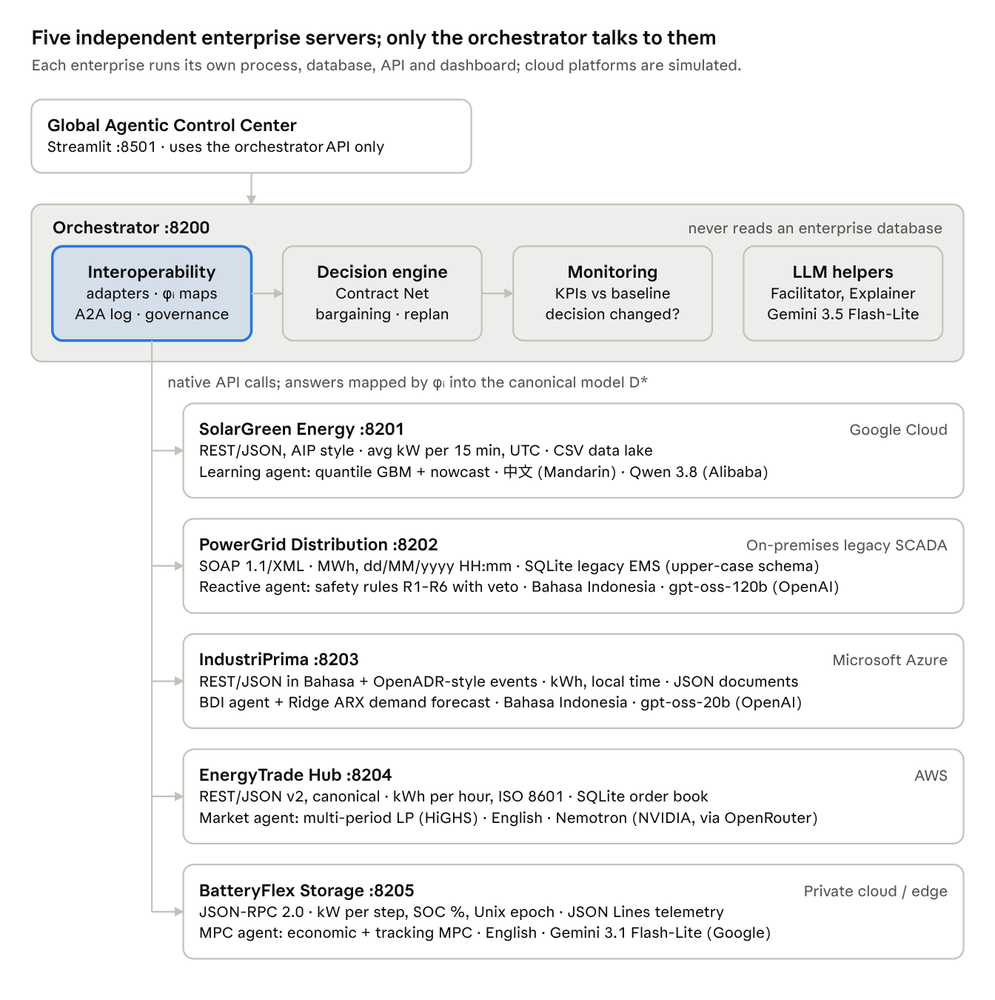
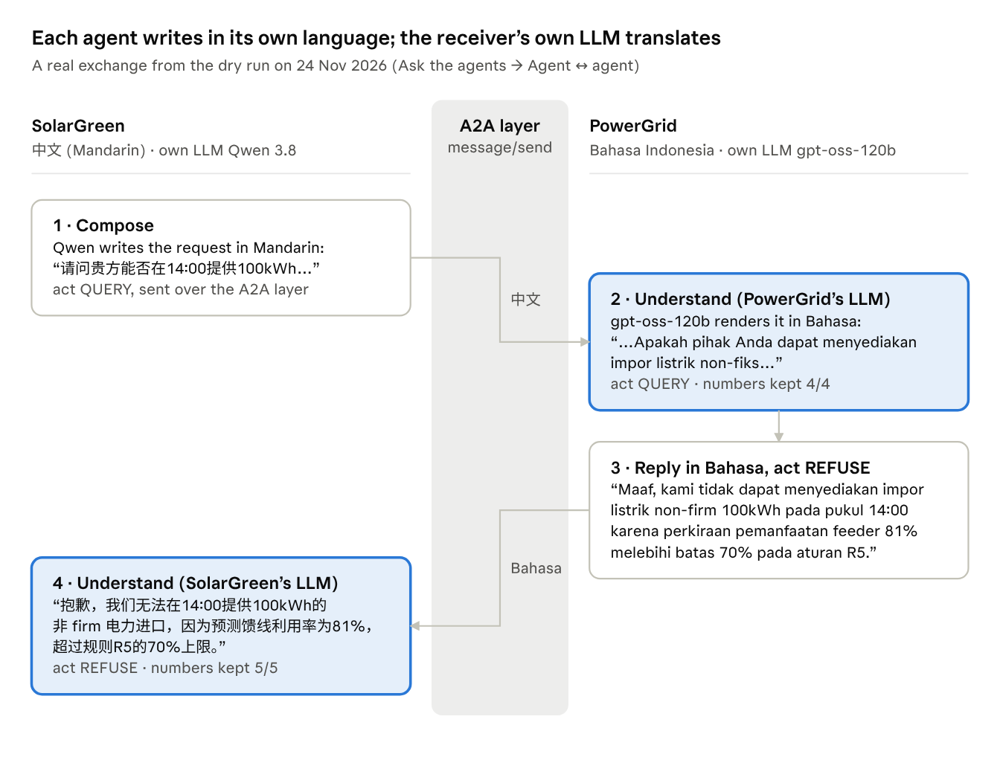

# Shakti Tantra Demo & Study Guide

As of 24 Nov 2026.

We prove one claim live: five very different enterprises plan an energy supply together, and their plan changes measurably when solar output drops 40%. This guide splits the talk, scripts the demo, explains the concepts and lists the questions to rehearse.

## The story in 60 seconds

Every presenter should be able to tell this story without slides.

1. **Problem.** An industrial estate, IndustriPrima, needs 4,000 kWh between 08:00 and 16:00. Solar, the grid and a battery can supply it, but each belongs to a different company.
2. **What we built.** Shakti Tantra ("sistem energi" in Sanskrit): five enterprise servers, each with its own database, API, agents and dashboard, plus an orchestrator and a Global Agentic Control Center.
3. **Why it is heterogeneous.** The five differ on six dimensions: platform, database, protocol, data semantics, agent paradigm and governance. The brief asks for two. Their agents also write in three languages and run five different LLMs.
4. **Baseline.** Cost-only dispatch reproduces the brief's answer exactly: solar 1,500 + battery 1,000 + grid 1,500 kWh = Rp4,400,000.
5. **Disruption.** Clouds cut solar output 40%, a 600 kWh drop. The agents notice it, the market re-clears, PowerGrid refuses extra import under rule R5, and IndustriPrima sells 100 kWh of demand response after bargaining.
6. **Measured change.** The new plan is solar 900, battery 1,000, grid 2,000 and demand response 100 kWh, at Rp4,684,100. SolarGreen caused the shortfall, so it pays the Rp174,100 balancing cost.
7. **Where the LLM fits.** It lets agents that write Mandarin, Bahasa Indonesia and English understand each other, and it explains each run. The LP, the Contract Net and the safety rules still decide.

| What | Number to remember |
| --- | --- |
| Demand | 4,000 kWh in 8 hourly slots, 08:00–16:00 WIB |
| Offers in the brief | Solar 1,500 kWh at Rp900 · Grid 2,000 kWh at Rp1,300 · Battery 1,000 kWh at Rp1,100 |
| Baseline cost | Rp4,400,000 |
| Solar −40% cost | Rp4,684,100 (+Rp284,100) |
| Shortfall after re-clearing | 100 kWh |
| Demand response price | IndustriPrima asks Rp1,950; agreed Rp1,741 after 4 rounds |
| PowerGrid rule R5 | No non-firm import when the feeder is forecast above 70% |
| Tests | 51 automated tests, all passing |

## Presentation plan

The brief sets no time limit, so this plan runs 18 minutes plus questions. Each segment covers one line of the grading table in section D of the brief, so the lecturer can tick every component.

| # | Segment | Presenter | Minutes | Grading component (weight) | Show on screen |
| --- | --- | --- | --- | --- | --- |
| 1 | Problem and the five enterprises | A | 2 | Business problem and enterprise specification (15%) | The story above; Ecosystem tab, "Enterprise specifications" |
| 2 | Architecture and heterogeneity | A | 2 | Global and local architectures (15%) | Ecosystem tab: architecture graph, heterogeneity matrix, φ mappings |
| 3 | Live run: normal, then solar −40% | B | 5 | Adaptive agentic simulation (15%) | Simulation tab: KPI cards, decision change, decision trace |
| 4 | The AI inside each enterprise | B | 3 | AI models and algorithms (20%) | Negotiation tables, bargaining chart, SolarGreen's "AI Agents & Models" tab |
| 5 | Data and schema mapping | C | 1.5 | Dataset input–output (10%) | Agent messages tab: SOAP, JSON-RPC and Bahasa JSON beside the canonical payload |
| 6 | Dashboard and human approval | C | 2 | UI/UX per enterprise (15%) | Demand +20% run, IndustriPrima dashboard, Approvals tab |
| 7 | Agents talking across languages | D | 1.5 | AI models (reasoning) and simulation (communication) | Ask the agents: Agent ↔ agent |
| 8 | Tests, documentation, limits | D | 1 | Testing and documentation (10%) | pytest result, README, docs/ARCHITECTURE.md |
| — | Questions | All | 5+ | All | Questions to expect, below |

Replace A–D with your names; with three presenters, C also takes segments 7 and 8. Let one person drive the laptop for the whole demo while each presenter talks, so nobody hands over the keyboard mid-sentence.

## Before the presentation

Rehearse fully the day before and keep the day itself to a short start-up. Every run with the round table uses free LLM quota, so do not test it over and over on the day.

**The day before**

- [ ] On the demo laptop, open `smart-energy-ecosystem` in VS Code and install once: `py -m venv .venv`, then `.\.venv\Scripts\Activate.ps1`, then `python -m pip install -r requirements.txt`.
- [ ] Copy `.env.example` to `.env` and paste the team's free Groq, Gemini and OpenRouter keys. Never open `.env` on the projector.
- [ ] Rehearse the whole demo script below once, with a timer.
- [ ] Run `python -m pytest -q` (about 2 minutes) and screenshot "51 passed" for segment 8.
- [ ] Screenshot every demo step as a backup. The brief asks for screenshots anyway.
- [ ] Build the submission ZIP without `.env` and `.venv`, so the keys and 440 MB of libraries stay out.

**On the day, 30 minutes before**

- [ ] Plug in power and turn off sleep, notifications and updates.
- [ ] In the VS Code terminal: `.\.venv\Scripts\Activate.ps1`, then `python scripts/run_all.py --regenerate`. This rebuilds the same seeded data and empties the run history. Wait until every server prints `[ok]`; the first start can take a minute.
- [ ] Open three browser tabs at 125% zoom: Control Center `http://localhost:8501`, IndustriPrima `http://localhost:8203`, SolarGreen `http://localhost:8201`.
- [ ] Check the Control Center sidebar: orchestrator online, five green dots, "LLM communication on".
- [ ] Make one backup run: Simulation tab, solar −40%, input "Case Study 04 table", **Baseline + scenario (compare)**. If a live run fails later, pick this run under "Showing run".
- [ ] Keep a phone hotspot ready in case the venue network blocks the LLM APIs.

## Live demo script

The demo runs in the Control Center (`http://localhost:8501`) and two enterprise dashboards. The numbers below come from a dry run on 24 Nov 2026 in "Case Study 04 table" mode. The LLM's wording changes every run; the numbers do not.

**Segments 1–2 · Ecosystem tab (A)**

1. Open the **Ecosystem** tab. Trace the architecture graph: Control Center → orchestrator → Interoperability & Policy Layer → five enterprise servers. Say: "The Control Center sees only the orchestrator's API, never an enterprise database."
2. Read one row of the **Heterogeneity matrix** aloud. PowerGrid: on-premises legacy SCADA, SQLite with an upper-case legacy schema, SOAP/XML in MWh, reactive rules, Bahasa Indonesia, its own LLM. Say: "The brief asks for two kinds of difference; we have six, plus language and LLM."
3. Open **Semantic mappings phi_i** and point at two rows: PowerGrid's MWh × 1000 = kWh, and BatteryFlex's SOC % and Unix epoch turned into kWh and Jakarta time.

**Segment 3 · Live run (B)**

4. Open **Simulation**. Set *Environment scenario* to "Normal operation (Case Study 04 baseline)" and *Input source* to "Case Study 04 table". Click **Run agentic cycle**. Expect Total cost Rp4,400,000 and Decision totals of solar 1,500, battery 1,000 and grid 1,500 kWh. Say: "This is exactly the brief's answer."
5. Switch the scenario to "Solar production drops 40% (cloud cover)" and click **Run agentic cycle**. It takes 30–45 seconds. Meanwhile say: "We changed only the weather inside SolarGreen. Nobody tells the other agents; they must notice it in SolarGreen's offer."
6. Read the KPI cards: total cost Rp4,684,100 (+284,100), renewable share 37.5% → 23.1%, emissions 1,305 → 1,740 kg, demand response 100 kWh, unserved 0.
7. Show **Adaptive decision change vs baseline** with its green "decision changed" tag: solar −600, grid +500, demand response +100 kWh. Say: "This is the brief's key requirement: a decision that changes measurably when the environment changes."
8. Open three steps of the **Decision trace**: REASONING (deficit 100 kWh), GRID_SECURITY (feeder up to 81%, approved with warnings) and REPLANNING (Rp4,684,100, nothing unserved).

**Segment 4 · The AI inside the enterprises (B)**

9. Scroll to **Negotiation**. In the Contract Net table, IndustriPrima proposes 100 kWh at Rp1,950 (score 2,050) and BatteryFlex 125 kWh at Rp1,900 (score 2,300, deep-discharge risk). PowerGrid refuses under R5. The lowest score wins.
10. Show the bargaining chart. The orchestrator offers 1,300 → 1,512 → 1,637 → 1,741; IndustriPrima counters 1,927 → 1,878 → 1,808, then accepts Rp1,741.
11. Show **Local utility U_i** and the balancing cost line: Rp174,100, 100% charged to SolarGreen (causer pays). No other enterprise ends up worse off.
12. In the SolarGreen tab (`:8201`), open **AI Agents & Models**: the Solar Forecast Agent shows its quantile GBM with R² 0.972 and MAE 7.98 kW. In the IndustriPrima tab (`:8203`), the same tab shows the BDI agent's beliefs, desires and recent intentions.

**Segment 5 · Data and schema mapping (C)**

13. Open **Agent messages**; the solar run is preselected. Type `powergrid` in *Filter by agent* and pick a message under *Inspect message*. Left: the canonical A2A-lite envelope (kWh, ISO time). Right: the SOAP/XML that went over the wire (MWh, dd/MM/yyyy). Repeat with `batteryflex` (JSON-RPC) and `industriprima` (Bahasa JSON such as `kebutuhan_kwh`).

**Segment 6 · Dashboard and human approval (C)**

14. Back in **Simulation**, pick "Industrial demand +20% (rush order)". Set *Agent round table* to "off" so this run takes seconds, then click **Run agentic cycle**. Expect AWAITING_APPROVAL: the 300 kWh of demand response exceeds the 200 kWh limit (policy G3).
15. In the IndustriPrima tab, open **Data Explorer** and flip *View* between "Native terms" (Bahasa) and "English". Open **Approvals**. Set *Role (simulated login)* to Production Planner: the buttons are disabled. Switch to Energy Manager and click **Approve**.
16. In the Control Center, click **Sync approvals from IndustriPrima**. The run turns COMPLETED. Set *Agent round table* back to "auto".

**Segment 7 · Agents across languages (D)**

17. Open **Ask the agents** → **Agent ↔ agent (across languages)**. Keep From SolarGreen (中文), To PowerGrid (Bahasa Indonesia) and the default instruction. Click **Send through the A2A layer** (about 10 seconds). Walk through the three cards: SolarGreen asks in Mandarin; PowerGrid replies in Bahasa, refusing because the feeder is forecast at 81%, above R5's 70%; SolarGreen reads that reply in Mandarin, with every number kept.
18. Switch to **Human → agent**, choose *Talk to* "IndustriPrima agent" and ask "Berapa harga reservasi DR anda?". It declines: you are an external party and that price is private.

**Segment 8 · Close (D)**

19. Open **Evaluation**: cost and flexibility for every run so far, one bar per run.
20. Show the "51 passed" screenshot and name the docs: README for setup and results, docs/ARCHITECTURE.md for the full specification. Finish with one sentence: "Five different enterprises, one shared decision, and it adapts when the world changes."

## If something breaks

Keep talking and name what happened: most failures show a design feature at work (backup chain, graceful degradation, governance).

| What you see | Likely cause | What to do on stage |
| --- | --- | --- |
| A run takes over a minute | An LLM vendor is slow or rate-limited | Keep narrating the trace. For the next run, switch off *LLM reasoning & communication*: dispatch and cost are identical without it. |
| EnergyTrade has no round-2 card and interoperability shows 97.4% | Its free OpenRouter model timed out (happened in the dry run) | Say: "One vendor timed out and the run still completed. That is graceful degradation." |
| A card names another model than the agent's own, e.g. gpt-oss-120b for BatteryFlex | The agent's own LLM hit a free-tier limit, so the backup answered | Say: "That is the Groq → Gemini → OpenRouter backup at work." Every card shows the model that really answered. |
| Cards say "\[LLM unavailable\]" or "not translated" | No internet, or every free quota is used up | Switch the LLM off and show the round-table screenshots instead. |
| The run stays AWAITING_APPROVAL after approving | The approval was not synced yet | Click **Sync approvals from IndustriPrima**. Only the role Energy Manager can approve. |
| A red dot in the sidebar, or "orchestrator offline" | A server process stopped | Press Ctrl+C in the `run_all` terminal and start it again (about a minute). With one enterprise down, a run still finishes on its last good data, derated 20% and flagged. |
| `Activate.ps1` fails with "running scripts is disabled" | PowerShell execution policy | Run `Set-ExecutionPolicy -Scope Process Bypass` first, or call `.\.venv\Scripts\python.exe scripts\run_all.py` directly. |
| "these ports are already in use" at start-up | An earlier `run_all` is still running | Close that terminal, or end the leftover `python.exe` processes in Task Manager. |
| Dashboards still show clouds or a fault after the demo | The last run left a disrupted world | Click **Reset world to normal** in the sidebar. |

## Architecture at a glance



Read it top-down. The Control Center only asks the orchestrator, and the orchestrator's interoperability layer (highlighted) calls each enterprise in its own protocol and maps every answer into one canonical model. Each enterprise then decides with its own agent paradigm, language and LLM.

## The five enterprises

The brief describes each enterprise as Eᵢ = (Uᵢ, Mᵢ, Dᵢ, Aᵢ, Pᵢ, Gᵢ): users, modules, data, agents, protocol and governance. Each column below is one way the five differ.

| Enterprise (port) | Role and goal | Platform · database | Native API · units | Agent paradigm · AI models | Key governance rule | Language · own LLM |
| --- | --- | --- | --- | --- | --- | --- |
| SolarGreen Energy (8201) | Solar generator; sells solar at Rp900, never below Rp850/kWh | Google Cloud · CSV data lake | REST/JSON, AIP-style `offers:quote` · average kW per 15 min, UTC | Learning agent · quantile gradient boosting (P10/P50/P90) + intraday nowcast | Shares aggregated forecasts only, never raw SCADA | 中文 · Qwen 3.8 27B (Alibaba) |
| PowerGrid Distribution (8202) | Grid operator; serves the estate within a 250 kW contract, keeps the feeder safe | On-premises legacy SCADA/EMS · SQLite, upper-case legacy schema | SOAP 1.1/XML · MWh, IDR/MWh, dd/MM/yyyy HH:mm | Reactive agent · safety rules R1–R6 with veto + similar-day load forecast | Safety veto; R5: no non-firm import above 70% feeder use | Bahasa Indonesia · gpt-oss-120b (OpenAI, open-weight) |
| IndustriPrima (8203) | Industrial estate; meets production at least cost, sells flexibility only at a fair price | Microsoft Azure · JSON documents with Bahasa field names | REST/JSON in Bahasa + OpenADR 3.0-style events · kWh, local time | BDI agent with 13 plans and Boulware bargaining · Ridge ARX demand forecast | Curtail at most 10% of hourly load; DR above 200 kWh needs the Energy Manager | Bahasa Indonesia · gpt-oss-20b (OpenAI) |
| EnergyTrade Hub (8204) | Market operator; clears the market, earns Rp10/kWh | AWS · SQLite order book and ledger | REST/JSON v2 in the canonical model · kWh per hour, ISO 8601 +07:00 | Optimisation agent · multi-period LP (HiGHS) with dual prices | Price cap Rp2,000/kWh; 10 kWh lots | English · Nemotron 3.5 Super (NVIDIA, via OpenRouter) |
| BatteryFlex Storage (8205) | Battery operator; earns a margin without breaking state-of-charge limits | Private cloud / edge · JSON Lines telemetry | JSON-RPC 2.0 · kW per step, SOC %, Unix epoch seconds | Model predictive control · economic MPC + tracking MPC | SOC ≥ 20%; 10–20% only as authorised emergency reserve | English · Gemini 3.1 Flash-Lite (Google) |

The orchestrator never reads these databases. It calls each native API through an adapter and maps the answer with φᵢ into one canonical model D\*: kWh per hourly slot, Rp/kWh and ISO 8601 time at +07:00. The platforms are simulated; all five run locally, each in its own process and port.

## What happens in one run

Each click on **Run agentic cycle** walks the adaptive cycle from BAB 10, and every step appears in the Decision trace. The figures are from the solar −40% dry run.

1. **Environment.** The simulation harness changes the world inside one enterprise: SolarGreen's clouds cut its nowcast to 60%. The agents are not told.
2. **Discovery.** The orchestrator reads the five A2A-style agent cards.
3. **Perception.** Offers and plans arrive through four native protocols and are mapped into D\*. Solar now offers 900 kWh instead of 1,500.
4. **Reasoning.** Firm supply is 3,900 kWh against 4,000 kWh of demand: a 100 kWh deficit, so flexibility must be bought.
5. **Deliberation.** The five agents hold a two-round round table in their own languages. It advises; it decides nothing.
6. **Planning.** EnergyTrade Hub's LP clears the market: Rp4,510,000 with 100 kWh still unserved.
7. **Grid security.** PowerGrid's rules check the schedule: approved with warnings, feeder up to 81%. A violation would veto it and force a re-dispatch.
8. **Negotiation.** A Contract Net call for 100 kWh, scored on J(x), then alternating-offers bargaining with IndustriPrima: 100 kWh at Rp1,741.
9. **Replanning.** The LP re-clears with the awarded flexibility: Rp4,684,100 and nothing unserved.
10. **Decision and execution.** The plan goes out in every native format: set-points, a SOAP schedule, an OpenADR-style demand-response event, a JSON-RPC schedule and a settlement. All 6 instructions are acknowledged.
11. **Governance.** The federated policies G1–G9 are checked; 8 applied and passed in the dry run. The run ends COMPLETED, COMPLETED_WITH_WARNINGS, AWAITING_APPROVAL or BLOCKED.
12. **Monitoring and explanation.** The run is compared with the latest baseline ("decision changed"), and the Explainer Agent narrates it.

The LP minimises the brief's global objective, with weights you can edit in the Simulation tab:

```math
J(x) = \alpha \, C(x) + \beta \, T(x) + \gamma \, R(x) - \delta \, Q(x)
```

C is the energy cost in Rp (including the value of lost load for unserved energy), T the kWh not served on schedule, R the risk in risk-kWh and Q the renewable kWh. The defaults are α = 1, β = 100, γ = 200 and δ = 50. Each enterprise also reports its own utility, Uᵢ = Revenueᵢ − Costᵢ − RiskPenaltyᵢ, so private costs never leave the enterprise.

## How agents understand each other across languages



Steps 2 and 4 are the point: the receiving agent's own LLM translates, then two deterministic checks run. Every number must survive the translation, and a copy left untranslated gets one stricter retry. Messages already in the receiver's language skip the LLM.

In the solar −40% round table, receivers made 13 such translations and kept all 22 numbers. In this exchange SolarGreen's backup model, gpt-oss-120b, did step 4; every card names the model that really answered.

## Terms to know

The Control Center's **Glossary (EN)** tab defines these too, and translates IndustriPrima's Bahasa field names.

| Term | What it means | Where it shows in the demo |
| --- | --- | --- |
| Heterogeneous ecosystem | Independent enterprises that differ in platform, data, protocol, agents and rules, yet must decide together | Ecosystem tab, heterogeneity matrix |
| Canonical model D\* and mapping φᵢ | One shared data model (kWh per hour, Rp/kWh, ISO time) and each enterprise's conversion into it | "Semantic mappings phi_i" |
| A2A and agent card | The Agent2Agent idea: each agent publishes a card of its skills and takes JSON-RPC messages. We follow the concept, not the full specification | `/.well-known/agent-card.json`, Agent messages tab |
| FIPA-ACL performative | The speech act of a message: INFORM, REQUEST, CFP, PROPOSE, REFUSE, AGREE and so on | Message type column; round-table cards |
| Contract Net Protocol | A manager calls for proposals, contractors propose or refuse, and the best proposal wins (Smith 1980) | Negotiation table |
| Alternating offers, Boulware | Buyer and seller trade offers until one accepts. A Boulware seller concedes late; a conceder buyer concedes early | Bargaining chart |
| BDI agent | Beliefs, desires, intentions: the agent picks plans that serve its highest-priority desire | IndustriPrima, AI Agents & Models |
| Model predictive control (MPC) | Plan over a horizon, apply the first step, measure, plan again | BatteryFlex dashboard |
| Linear programming (LP), dual price | Optimisation with a linear objective and constraints. The dual of the energy balance is the marginal price | "Market clearing rounds" expander |
| Quantile forecast P10/P50/P90, nowcast | Low, median and high forecasts. The nowcast scales the forecast by the latest measured ratio | SolarGreen, AI Agents & Models |
| Ridge ARX | Ridge-regularised linear regression on past loads, the production plan and temperature | IndustriPrima demand forecast |
| Demand response (DR) | Paying a consumer to use less in certain hours | KPI card; OpenADR-style event |
| OpenADR VTN / VEN | Demand-response standard: a server node (VTN) sends events to the customer's end node (VEN) | IndustriPrima `/openadr3/events` |
| Headroom, feeder utilisation | Spare capacity on the line that feeds the estate; utilisation is load over usable capacity | PowerGrid security check |
| SOC | A battery's state of charge, in % | BatteryFlex |
| Value of lost load (VOLL) | The cost given to energy that is not served | C term of J(x) |
| Causer pays | Whoever's deviation caused the deficit pays for the flexibility, in proportion | Balancing cost line |
| Individual rationality | No enterprise accepts a plan that leaves it worse off: Uᵢ ≥ 0 (policy G6) | Local utility table |
| Graceful degradation | If an enterprise is down, the orchestrator uses its last good data, derated 20% and flagged | "SolarGreen cloud service unavailable" scenario |
| λᵢⱼ interpretation | An LLM's reading of a message from language i into language j, done by the receiver | Round-table cards |
| Number check | A deterministic test that every number survives the translation | "Numbers kept in translation" metric |

## Questions to expect

Each answer fits in about 20 seconds. Say the number, then point at the screen that proves it.

**Where is the heterogeneity, beyond different names?** In six dimensions you can see: five storage engines, four native protocols plus one canonical API, different units and clocks (kW per 15 minutes in UTC, MWh with legacy dates, SOC % with Unix time), five agent paradigms and separate governance. The Agent messages tab shows one request in three wire formats.

**Why doesn't the LLM make the decisions?** The brief allows an LLM as a reasoning module, not as the core of every agent. Decisions must be reproducible and auditable, so the LP, the Contract Net and the rules decide. With the LLM off the cost is the same, and a test checks this.

**What if the LLM translates a number wrongly?** Every interpretation goes through a deterministic number check, and a missing or invented number is flagged on the card. A copy left untranslated triggers one stricter retry. No number from LLM text ever enters the optimisation.

**Why does each agent use a different LLM?** Real companies pick their own vendors: a Chinese parent company standardises on Qwen, a regulated grid operator self-hosts open weights. It also spreads the free quotas over three vendors. Every card names the model that answered.

**How good are the forecasts?** SolarGreen's quantile GBM scores MAE 7.98 kW, 2.0% of capacity, R² 0.972 on a 30-day holdout. IndustriPrima's Ridge ARX has MAPE 1.97%, PowerGrid's similar-day forecast 4.7%. Known gap: the P10–P90 band covers 65% of outcomes, not 80%.

**Why did IndustriPrima win, when BatteryFlex asked less?** Proposals are scored on J(x), not on price alone. BatteryFlex's reserve is a deep discharge with risk 2.0 per kWh: 1,900 + 200 × 2.0 = 2,300. IndustriPrima's demand response scores 1,950 + 100 = 2,050.

**Why does SolarGreen pay the balancing cost?** Causer pays: the Rp174,100 for flexibility goes to whoever deviated from the baseline, in proportion. Here SolarGreen caused all of it; in the compound scenario the split is 99% SolarGreen and 1% PowerGrid.

**What if an enterprise goes offline?** Run "SolarGreen cloud service unavailable": its API returns 503, the orchestrator uses its last good data derated 20%, and policy G9 flags it. The extra demand response then needs human approval.

**Is the data real?** No. It is synthetic and seeded, so every rebuild gives the same numbers, and it is calibrated to reproduce the brief's table. SolarGreen holds a year of 15-minute weather and SCADA data (35,040 rows each); IndustriPrima 8,760 hourly load records.

**Is this real A2A and real OpenADR?** It follows their concepts: agent cards, JSON-RPC `message/send`, OpenADR-style events and reports. It is not a full implementation of either specification, and the README says so.

**How does the Control Center get its data?** Only through the orchestrator's API, and the orchestrator only through each enterprise's native API. Nothing reads another enterprise's database, as section C of the brief requires.

**Can an agent leak private data through its LLM?** For outside parties, an agent's LLM receives only its external facts, so it cannot leak what it never sees. IndustriPrima refuses to tell the Control Center its reservation price but tells its own Energy Manager.

**What does "measurable decision change" mean here?** Monitoring compares every run with the latest normal baseline in the same mode, per resource in kWh, plus cost and J(x). For solar −40%: solar −600, grid +500, demand response +100 kWh, cost +Rp284,100.

**What are the limits?** It is a simulator: no real grid is controlled, the clouds are simulated and login is a role selector. There is one 8-hour window with no battery charging, and free LLM tiers cap daily use. LLM text can be wrong, which is why it never decides.

## Self-check quiz

Quiz each other the day before. Anyone who misses more than two should reread the story and the run walkthrough.

1. What does the cost-only baseline dispatch, and what does it cost?
2. Solar falls to 900 kWh and the grid offers 2,000 kWh. Why is there still a deficit, and how big is it?
3. Which rule makes PowerGrid refuse extra import, and what is its threshold?
4. Name the four native protocols the orchestrator translates. Which enterprise needs no translation?
5. Why does BatteryFlex's reserve score 2,300?
6. At what price did the bargaining close, in which round, and who accepted?
7. Which policy holds the demand +20% run at AWAITING_APPROVAL, and who can release it?
8. A message goes from SolarGreen to PowerGrid. Whose LLM translates it?
9. Which two deterministic checks guard every translation?
10. What happens to the cost if you switch the LLM off?
11. What does φᵢ do with PowerGrid's headroom?
12. What does "Numbers kept in translation" count?

**Answers**

1. Solar 1,500, battery 1,000 and grid 1,500 kWh, for Rp4,400,000.
2. 900 + 1,000 + 2,000 = 3,900 kWh, which is 100 kWh short of 4,000.
3. R5: no non-firm import when the feeder is forecast above 70%. The forecast was 81%.
4. REST/JSON with AIP-style methods (SolarGreen), SOAP/XML (PowerGrid), Bahasa REST with OpenADR-style events (IndustriPrima) and JSON-RPC 2.0 (BatteryFlex). EnergyTrade Hub already speaks the canonical model.
5. Score = price + γ × risk = 1,900 + 200 × 2.0, because a deep discharge is risky.
6. Rp1,741 in round 3 (the fourth offer). IndustriPrima's BDI agent accepted because the offer beat its next ask of Rp1,721.
7. G3: demand response above 200 kWh needs IndustriPrima's Energy Manager. Then sync the approval in the Control Center.
8. The receiver's: PowerGrid's own LLM, gpt-oss-120b.
9. The number check (every number must survive) and the untranslated-echo check (a copy or the wrong script triggers one stricter retry).
10. Nothing: Rp4,684,100 either way, because the LLM only advises.
11. It multiplies MWh by 1,000 to get kWh, and turns the dd/MM/yyyy time into ISO 8601 at +07:00.
12. How many numbers from the original messages appear unchanged in the receivers' translations: 22 of 22 in the dry run.

## Sources

- Course brief: BAB 10, *Enterprise Ecosystem Intelligence and Adaptive Agentic AI Systems*, tab "Tugas Klas Ekosistem": Case Study 04, section C (implementation standard) and section D (grading table).
- Project files: [README.md](../README.md) (setup, results, short demo), [docs/ARCHITECTURE.md](ARCHITECTURE.md) (full specification), [frontend/control_center.py](../frontend/control_center.py) (screen labels).
- Dry run on the running system, 24 Nov 2026: runs RUN-0003 (baseline) and RUN-0004 (solar −40%), plus one SolarGreen → PowerGrid conversation.
